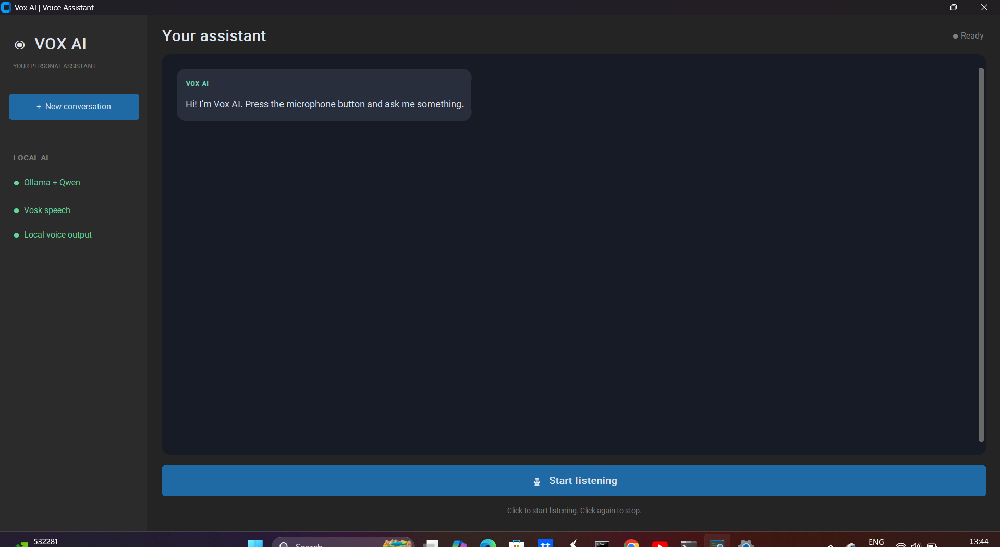

# VOX AI — Local Voice Assistant

A desktop voice assistant built with Python, Vosk, Ollama, and a local Qwen model. It listens through your microphone, transcribes speech, generates a response locally, and reads the response aloud. The project also includes a CustomTkinter desktop GUI with conversation history and a microphone control.

> **Portfolio note:** This repository is a personal learning project. Review the setup steps and replace the screenshot placeholders with screenshots from your own running application before sharing it with recruiters.

## Features

- **Voice input:** speech recognition using Vosk and a local model folder.
- **Local LLM responses:** sends recognized text to Ollama using `qwen2.5:1.5b`.
- **Spoken answers:** text-to-speech with `pyttsx3`.
- **Desktop interface:** CustomTkinter dark-themed UI, conversation history, and start/stop listening controls.
- **Local-first inference:** prompts are sent to the Ollama model running on your own computer; Vosk handles speech recognition locally. (Ollama/model must be installed and running.)
- **Separate console entry point:** keep `app.py` available as a simple way to run the assistant without the GUI, if that entry point remains in the repository.

## Demo screenshots

Add your real screenshots to the `assets/` folder using these filenames:

| Screenshot | What to capture |
|---|---|
| `assets/voice-assistant-gui.png` | The main application window, showing the sidebar and conversation area |
| `assets/voice-assistant-conversation.png` | A completed example conversation with a user prompt and assistant response |

Once those files exist, the images below will render on GitHub.

### Main interface



### Example conversation


**Screenshot tip:** use a harmless test prompt such as “Explain Java classes and objects in simple terms.” Do not include API keys, private messages, personal notifications, or other sensitive information in screenshots.

## Tech stack

- **Python 3.13** (recommended for the current environment)
- **CustomTkinter** — desktop GUI
- **Vosk** — offline speech recognition
- **Ollama** — local model runtime
- **Qwen 2.5 1.5B** — language model (`qwen2.5:1.5b`)
- **pyttsx3** — text-to-speech
- **sounddevice** — microphone audio input

## How it works

1. The microphone captures audio.
2. Vosk converts speech into text using the local `model/` directory.
3. The recognized text is sent to Ollama's locally running Qwen model.
4. The assistant response appears in the chat history.
5. `pyttsx3` reads the response aloud.

```text
Microphone → sounddevice → Vosk speech-to-text
                              ↓
GUI / conversation history ← Ollama (Qwen 2.5 1.5B)
                              ↓
                       pyttsx3 text-to-speech
```

## Requirements

- Windows 10/11 (the instructions below are written for Windows)
- Python 3.13 recommended
- Ollama installed and running
- The `qwen2.5:1.5b` model downloaded in Ollama
- A compatible microphone and speakers/headphones
- The Vosk English model extracted into a folder named `model/` at the project root

## Setup on Windows

### 1. Clone the repository

Open Command Prompt or PowerShell:

```powershell
git clone https://github.com/VishuddhaPatil/voice-AI-prototype.git
cd voice-AI-prototype
```

If you already have the repository locally, navigate to its folder instead.

### 2. Create and activate a virtual environment

```powershell
py -3.13 -m venv .venv
.\.venv\Scripts\Activate.ps1
```

For **Command Prompt (cmd.exe)**, activate it with:

```bat
.venv\Scripts\activate
```

If Python 3.13 is not registered with the `py` launcher, install Python 3.13 and select the option to add Python to PATH, or use the full path to `python.exe`.

### 3. Install Python dependencies

```powershell
python -m pip install --upgrade pip
python -m pip install -r requirements.txt
```

### 4. Install Ollama and download the model

Install Ollama from [ollama.com/download](https://ollama.com/download), then open a terminal and run:

```powershell
ollama pull qwen2.5:1.5b
ollama run qwen2.5:1.5b
```

Type a short prompt to verify that the model responds, then type `/bye` to exit. Ollama should be running when you launch VOX AI.

### 5. Add the Vosk speech model

Download a small English model from the [official Vosk models page](https://alphacephei.com/vosk/models). For example, `vosk-model-small-en-us-0.15` is a compact English model.

Extract the archive and rename the extracted model folder to `model`, so the project structure looks like this:

```text
voice-AI-prototype/
├── app.py
├── gui.py
├── requirements.txt
├── README.md
├── model/
│   ├── am/
│   ├── conf/
│   ├── graph/
│   └── ivector/   # present in some model packages
└── ...
```

The model directory should contain the model files directly. Avoid accidentally nesting it as `model/vosk-model-small-en-us-0.15/...` unless your code's `MODEL_PATH` is updated to match.

### 6. Run the application

Start the GUI:

```powershell
python gui.py
```

Click **Start listening**, say a short question, and pause so the recognizer can finalize the utterance. Click **Stop listening** when finished.

If your repository includes the console version, you can also try:

```powershell
python app.py
```

## Troubleshooting

- **`ModuleNotFoundError`:** activate `.venv` and run `python -m pip install -r requirements.txt`.
- **Ollama connection/model error:** check `ollama list`, then run `ollama pull qwen2.5:1.5b`. Make sure Ollama is running.
- **Vosk model error:** verify that the `model/` folder exists in the project root and contains `am`, `conf`, and `graph`.
- **No microphone input:** check Windows Settings → Privacy & security → Microphone and allow desktop apps to access it. Confirm the intended input device is enabled.
- **No sound output:** check Windows output-device selection and volume. `pyttsx3` uses the system's available speech engine.
- **GUI dependency missing:** run `python -m pip install customtkinter` inside the activated virtual environment.
- **Speech is cut off or fragmented:** pause briefly after speaking; microphone quality, room noise, and Vosk endpoint detection affect transcription.

## Repository hygiene

Large model files and local environments should not be committed. The `.gitignore` file excludes `.venv/`, Python caches, and the local `model/` directory. Add a note in the README (as above) explaining how to download the model separately.

## Future improvements

- Editable text input and text-only responses
- Configurable model selection and microphone device
- Better handling of false starts and noisy environments
- Unit tests for prompt handling and conversation logic
- Build a Windows executable for easier installation

## Author

**Vishuddha Patil**

- GitHub: [VishuddhaPatil](https://github.com/VishuddhaPatil)

## License

Choose and add a license before inviting reuse or contributions. If you want other people to use, modify, and distribute the project, the MIT License is a common permissive option; only add it if you are comfortable with those terms.
